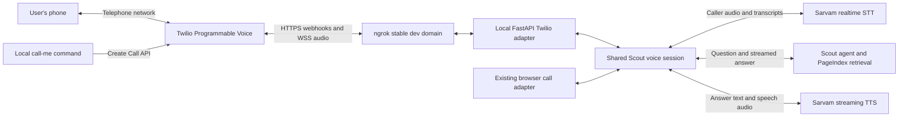

# Scout phone call integration plan

Status: implemented with local protocol, regression, and live Sarvam codec verification.
Real Twilio calls and the public tunnel remain unverified until account credentials and streaming access are configured.
Research date: 14 October 2026.
User context: local application, existing free Twilio account, caller in India, inbound and outbound calls requested.

## Recommendation

Use Twilio Programmable Voice with bidirectional Media Streams, an ngrok HTTPS tunnel, and the existing Scout voice agent with Sarvam STT/TTS.
Deliver inbound calling first, then a local command that asks Twilio to call the user's Indian mobile and connects it to the same conversation engine.
Keep the existing retrieval providers, language policy, and contextual interruption classifier.

The first dependency is account access: current Twilio trial documentation blocks `<Stream>` and `<ConversationRelay>`.
Treat a paid account upgrade as required unless the existing account is confirmed to have legacy access to Media Streams.
Earlier success with inbound calls does not establish access to bidirectional streaming today.
[Source: Twilio trial restrictions](https://www.twilio.com/docs/usage/trials/try-out-voice#blocked-verbs).

## Caller experience

Inbound: dial the configured Twilio voice number, hear Scout introduce itself, and ask questions naturally.
Outbound: run a local "call me" command, answer the incoming call, and have the same conversation with Scout.
The user can speak English, Hindi, or supported Indian languages and change language during the conversation.
Short acknowledgments should preserve Scout's answer; questions, corrections, "no", and "what?" should get a contextual turn decision.
Each phone call starts a fresh conversation, with context retained throughout that call.
Cross-call memory and linking a phone number to a browser conversation are separate future work.

## Architecture



Twilio handles the phone network and streams audio; the local backend runs conversation orchestration and retrieval.
Sarvam and the configured model providers remain external API services.
Both call directions use `<Connect><Stream>` once the call is answered.
`<Start><Stream>` only sends audio to the server and cannot carry Scout's audio back to the caller.
Bidirectional streams receive the caller's audio track, allow inbound keypad events, and are limited to one active stream per call.
[Source: Media Streams overview](https://www.twilio.com/docs/voice/media-streams).

## Account and India setup

1. Inspect the existing account's trial status, expiration, current voice number, and Media Streams entitlement in Twilio Console.
2. Confirm the user's Indian mobile is a verified recipient if the account is still trial-limited.
3. If the current trial restrictions apply, upgrade before attempting the real streaming acceptance test.
4. Choose a voice-capable non-Indian Twilio number, preferably reuse an eligible existing number.
5. Confirm outbound Voice geographic permissions permit India and the destination is reachable on the user's carrier.
6. For inbound testing with a non-Indian number, confirm the user's carrier supports international dialing and check its charges.

Twilio documents outbound calls to India as requiring an international, non-Indian caller number.
Do not use the user's `+91` mobile as the outbound caller ID.
An Indian inbound toll-free number is an optional later choice whose availability and provisioning must be checked in Console; do not assume a normal Indian local number can be purchased.
[Source: India Voice guidelines](https://www.twilio.com/en-us/guidelines/in/voice).

The current trial docs also restrict calls to verified numbers and the sign-up country.
An older account may differ; verify its actual capabilities rather than assuming either historic behavior or new trial allowances apply.
Twilio test credentials cannot establish a real phone/audio acceptance result.
[Sources: Voice trial](https://www.twilio.com/docs/usage/trials/try-out-voice), [test credentials](https://www.twilio.com/docs/iam/test-credentials).

## Public connection to localhost

Use ngrok's account-assigned dev domain for the first version.
Run the backend on port 8000 and run `ngrok http 8000` in a separate terminal.
Use the HTTPS hostname ngrok actually reports as `TWILIO_PUBLIC_BASE_URL`; derive the WSS hostname from it.
No purchased domain or router port forwarding is needed.
The current ngrok docs describe a stable dev domain on the free plan, with automatic HTTPS certificates.
[Sources: ngrok domains](https://ngrok.com/docs/gateway/domains#dev-domains), [free plan](https://ngrok.com/docs/pricing-limits/free-plan-limits).

| Tunnel | Fit for this application |
| --- | --- |
| ngrok dev domain | Recommended first: stable hostname, webhook inspection, and no owned domain required. |
| Cloudflare named tunnel | Good alternative if the user already has a domain on Cloudflare; use a fixed public hostname and permit Twilio's non-interactive HTTPS/WSS requests. |
| Cloudflare Quick Tunnel | Useful for temporary experiments, but its hostname changes on restart and it has no uptime guarantee. |

[Sources: Cloudflare setup](https://developers.cloudflare.com/tunnel/get-started/), [Quick Tunnel limitations](https://developers.cloudflare.com/tunnel/get-started/quick-tunnels/), [WebSocket support](https://developers.cloudflare.com/network/websockets/).

Ngrok's free browser warning does not apply to programmatic API access according to its docs.
Verify both the real Twilio webhook and WSS upgrade; do not rely solely on loading the URL in a browser.
The free plan currently includes 1 GB monthly outbound transfer and 20,000 HTTP requests, so watch actual usage during testing.
Keep public ingress limited to the telephony routes using a tunnel path policy; reject other backend paths through that public hostname.
Do not put an interactive login or browser challenge in front of Twilio's routes.
[Source: ngrok free plan limits](https://ngrok.com/docs/pricing-limits/free-plan-limits).

The laptop, backend, tunnel, and network must stay running for calls to work.
Use one backend worker initially because call state is process-local.
Disable development auto-reload during real calls, since a reload kills active sessions.
Stop the tunnel when phone testing ends.

## Current code and required changes

The current `backend/main.py` creates a shared voice agent and exposes the browser endpoint `/api/voice/ws`.
`backend/voice_pipeline.py` currently accepts browser protocol 2, receives binary PCM16 at 16 kHz, and uses browser playback feedback.
`backend/voice_response.py` produces browser WAV packets at 22.05 kHz with a protocol/response-ID prefix.
`backend/voice_language.py`, `backend/voice_activity.py`, and `backend/voice_interruption.py` already implement reusable conversation policies.
Twilio's JSON messages and raw telephony audio cannot be pointed directly at the browser WebSocket endpoint.

Extract a transport-neutral `VoiceSession` from the browser pipeline.
Give it typed setup, audio, playback-feedback, and disconnect events plus an output interface for audio, pause, resume, cancel, and errors.
Keep WebSocket acceptance, protocol validation, and audio packaging in separate browser and Twilio adapters.
The core owns language, agent turns, STT, inactivity, and response cancellation.
Each session has one STT connection; each answer owns its task, TTS connection, bounded queues, and response ID.

| Planned file | Responsibility |
| --- | --- |
| `backend/voice_session.py` | Shared session orchestration and transport-neutral events. |
| `backend/voice_pipeline.py` | Existing browser adapter, preserving protocol 2. |
| `backend/voice_response.py` | Format-aware synthesis; return codec/sample-rate metadata and raw audio without browser framing. |
| `backend/twilio_routes.py` | Signed TwiML, call callbacks, stream callbacks, and Media Streams endpoint. |
| `backend/twilio_transport.py` | Twilio message parsing, audio scheduler, playback marks, and clear handling. |
| `backend/twilio_security.py` | Signature validation, canonical public URLs, and call-session admission. |
| `backend/call_scout.py` | Local outbound command using Twilio's Calls API. |
| `backend/main.py` | Register routes and lifecycle cleanup. |
| `.env.example`, `requirements.txt`, `README.md` | Configuration, Twilio SDK dependency, and operating instructions. |

Regenerate any dependency lockfile through its owning tool if dependencies change.
Do not manually edit generated files or CHANGELOG files.

## Routes and call lifecycle

| Route | Behavior |
| --- | --- |
| `POST /api/telephony/voice` | Validate the signed form webhook, admit an allowed call, and immediately return TwiML connecting to the media endpoint. |
| `WSS /api/telephony/media` | Validate the handshake, process `connected`/`start`, then stream caller audio and Scout speech. |
| `POST /api/telephony/call-status` | Validate call-progress callbacks and reconcile terminal call states. |
| `POST /api/telephony/stream-status` | Validate stream-started, stream-stopped, and stream-error callbacks. |

Set the phone number's incoming voice handler to `https://<dev-domain>/api/telephony/voice`, method POST.
For outbound calls, the local command supplies the same TwiML webhook URL and call-status URL to `calls.create`.
Subscribe to initiated, ringing, answered, and completed events; account for busy, failed, canceled, and no-answer terminal statuses.
Run the synchronous SDK call off the async event loop, or use its supported asynchronous client.
[Source: Calls API](https://www.twilio.com/docs/voice/api/call-resource).

Return TwiML without waiting for retrieval or speech provider startup.
The connection target is `wss://<dev-domain>/api/telephony/media`.
Use nested `<Parameter>` entries for an opaque, short-lived session admission token; Twilio Stream URLs do not accept query parameters.
Bind admission to the signed AccountSid/CallSid and validate the `start` message against that reservation before opening provider sessions.
Use a fresh internal thread ID such as `phone:<CallSid>` and a fixed retrieval provider for the call.
Handle duplicate TwiML fetches without creating duplicate conversations, and accept only one active media connection per admitted call.
[Source: Stream parameters](https://www.twilio.com/docs/voice/twiml/stream).

After a validated stream starts and speech services are ready, have Scout greet the caller once through the normal speech path.
Apply startup and provider deadlines and an explicit failure path that closes the stream and lets a short fallback `<Say>` followed by `<Hangup>` execute.
Do not interpret WebSocket closure alone as proof the telephone call ended; include terminal TwiML and use the Calls API when an explicit hangup is needed.
[Source: bidirectional stream lifecycle](https://www.twilio.com/docs/voice/media-streams/websocket-messages#stop-message).

## Audio format

Twilio receives and sends base64-encoded, mono `audio/x-mulaw` at 8,000 Hz.
Outgoing audio must contain raw audio bytes, without WAV headers or Scout's browser protocol prefix.
[Source: Media Streams message contract](https://www.twilio.com/docs/voice/media-streams/websocket-messages).

For phone input, configure Sarvam realtime STT with `encoding="mulaw"`, `sample_rate=8000`, `language_code="auto"`, and VAD endpointing.
Validate each Twilio media payload and forward its audio to Sarvam without resampling.
For phone output, request `output_audio_codec="mulaw"` and `speech_sample_rate=8000` from streaming TTS.
Keep the current model/voice selections initially; check the exact installed SDK keyword names and provider compatibility in a live codec probe.
The lockfile currently pins `sarvamai==0.1.37`, while current documentation examples have evolved.
[Sources: Sarvam realtime STT](https://docs.sarvam.ai/api/api-guides-tutorials/speech-to-text/realtime-streaming), [TTS output formats](https://docs.sarvam.ai/api/api-guides-tutorials/text-to-speech/how-to/set-audio-format-for-output), [TTS sample rates](https://docs.sarvam.ai/api/api-guides-tutorials/text-to-speech/how-to/set-the-sample-rate).

Do not add a transcoding layer unless the codec probe establishes that direct μ-law is unavailable with the selected provider configuration.
If needed, use a stateful, tested resampler and G.711 conversion at the adapter boundary, preserving continuity between chunks.
If WAV parsing is required, parse the container rather than assuming every header is 44 bytes.

## Interruption and playback accounting

Twilio provides outgoing `media`, `mark`, and `clear` messages; it does not expose a reversible pause/resume command.
A `clear` discards its buffered audio and returns outstanding marks, including marks for audio that never played.
Therefore, mapping Scout's temporary pause directly to `clear` would lose audio on an acknowledgment.
[Source: mark and clear semantics](https://www.twilio.com/docs/voice/media-streams/websocket-messages).

Use one serialized outbound writer per call, and divide speech into small raw-audio frames.
Start with approximately 20 ms media frames, marks at approximately 100 ms boundaries, and at most approximately 200 ms outstanding playback.
These are engineering tuning values, not Twilio guarantees; measure them over actual calls.
Bound local audio retention by both bytes and duration and apply synthesis/generation backpressure.
Keep the inbound audio reader running independently of outbound pacing and classifier work.

On a temporary pause, stop adding audio to Twilio and let the small outstanding playback window drain.
Retain unsent audio locally and record incoming playback marks.
On acknowledgment, resume the same response from its retained audio.
The phone may play a short tail during the pause window; do not claim sample-exact browser-style pausing.

On a take-turn or uncertain decision, invalidate the old response, clear Twilio's buffer, cancel its agent/TTS tasks, and discard unsent old audio.
Track mark IDs by stream, response, and playback generation so marks returned after a clear cannot report successful playback or finish a successor response.
Check response ownership again immediately before sending queued audio.
Send a final response mark only after the last audio frame is sent; TTS completion alone does not mean the caller has heard the answer.
Classify every nonempty overlapping utterance with context, including one-word utterances, and preserve the current fail-open policy on classifier failures.

## Access, limits, and cleanup

Validate `X-Twilio-Signature` on every webhook and before accepting a media WebSocket.
Use Twilio's official request validator with `TWILIO_AUTH_TOKEN` and the externally visible URL, including all signed form parameters.
Build canonical URLs from `TWILIO_PUBLIC_BASE_URL`, not an untrusted Host or forwarded header.
Cover the WSS URL representation and Twilio's documented trailing-slash handshake edge case in tests and a real handshake probe.
Do not disable signature validation to make the tunnel work.
[Source: Twilio request security](https://www.twilio.com/docs/usage/security).

Initially allow only the user's configured mobile as an inbound caller and outbound destination.
Caller ID is a routing restriction, not identity verification for sensitive actions.
Keep the outbound command local instead of publishing an unauthenticated endpoint that can create paid calls.
Set an initial one-call concurrency limit and a configurable 10-minute call limit; return a clear busy response when capacity is used.
Set the outbound Calls API duration limit and apply an inbound watchdog as well.
Make outgoing dialing explicit and deduplicate local requests; do not retry an ambiguous call-creation timeout by placing a second call.

On stop, disconnect, terminal callback, fatal provider error, timeout, or server shutdown, cancel and await the call's tasks, close provider sockets, clear retained audio, and release admission state.
Reconcile duplicate and out-of-order callbacks without moving a terminal call back to an active state.
Keep active-call state in memory for this single-process local version and expire finished state.
Audit LangGraph's in-memory checkpoint retention and add a supported per-phone-thread cleanup path so completed calls do not accumulate indefinitely.
Use bounded logs for call IDs, timing, playback generations, and sanitized provider error codes; keep credentials, raw audio, and full phone numbers out of ordinary logs.
Call recording remains off.

## Configuration to add during implementation

```dotenv
TWILIO_ENABLED=false
TWILIO_ACCOUNT_SID=
TWILIO_AUTH_TOKEN=
TWILIO_PHONE_NUMBER=
TWILIO_PUBLIC_BASE_URL=
TWILIO_ALLOWED_PHONE_NUMBER=
TWILIO_RETRIEVAL_PROVIDER=decisions
TWILIO_MAX_CONCURRENT_CALLS=1
TWILIO_MAX_CALL_SECONDS=600
```

Store real credentials only in the existing ignored server `.env`.
Keep ngrok's authentication token in ngrok's own local configuration.
`TWILIO_AUTH_TOKEN` is needed for signature checks even if a separate Twilio API key is used for outbound REST calls later.

## Implementation sequence and acceptance gates

1. **Account and provider preflight.** Establish actual Media Streams access, number/carrier reachability, and a working live Sarvam input/output codec probe.
2. **Shared voice session.** Extract the core and preserve the existing browser call contract, language behavior, retrieval, and cancellation checks.
3. **Inbound vertical slice.** Add signed TwiML and WSS routes, the Twilio transport, greeting, playback marks, and cleanup; prove a real phone question and audible answer.
4. **Contextual interruptions.** Add bounded playback scheduling, reversible retention, clear-generation accounting, classifier timeouts, and stale-audio rejection.
5. **Outbound calling.** Add the local command for the configured Indian mobile, progress callbacks, no-answer handling, and duplicate prevention; prove an answered call reaches the same agent.
6. **Operating instructions and full verification.** Document the local launch/tunnel/Console workflow and record real-call latency, audio quality, failures, and cost.

A previous voice evaluation recorded an integrated Sarvam synthesis failure despite an isolated synthesis probe succeeding.
That is historical evidence from another checkout, not a confirmed failure in this checkout.
Revalidate provider configuration/session behavior in step 1 before attributing any silent phone call to Twilio or ngrok.

| Test layer | Required evidence |
| --- | --- |
| Unit and protocol tests | Valid/invalid signatures, canonical URLs, malformed media, account/stream admission, duplicate callbacks, canceled responses, mark/clear races, and bounded queues. |
| Shared voice regression | Existing language, inactivity, interruption, response ownership, retrieval, and browser playback suites pass. |
| Live provider probe | Sarvam recognizes real 8 kHz μ-law input and produces valid header-free μ-law output using the actual SDK/model settings. |
| Real inbound phone | Greeting, grounded college question, follow-up context, English/Hindi switching, and audible answer. |
| Real outbound phone | User's mobile rings, answered call reaches Scout, busy/no-answer is handled, and one request does not create duplicate calls. |
| Real interruption | "Okay" preserves the answer; "no", "what?", and a correction take a contextual turn; no canceled speech leaks into the next answer. |
| Failure and lifecycle | Caller hangs up, provider fails, tunnel stops, and backend shuts down; tasks terminate and the phone call ends or receives the configured fallback. |

Measure speech-end to first audible answer, VAD-to-playback-stop, outstanding playback duration, and provider startup time.
Report observed p50/p95 values and retrieval-dependent delays; do not promise a fixed sub-second reply.
Mock tests and a successful build do not establish phone/carrier/provider readiness.

## Cost expectations

These are public USD rates observed on 14 October 2026, before taxes, provider fees, credits, discounts, or account-specific pricing.

| Item | Observed public price |
| --- | --- |
| US local Twilio number | $1.15/month. |
| Inbound call to a US local number | $0.0085/minute. |
| Outbound to India mobile | $0.0496/minute. |
| Media Streams | $0.0044/minute. |

[Sources: US Voice pricing](https://www.twilio.com/en-us/voice/pricing/us), [India Voice pricing](https://www.twilio.com/en-us/voice/pricing/in).

For a US number, the illustrative Twilio subtotal is about $0.0129/minute inbound or $0.0540/minute outbound to India mobile with Media Streams.
Ten outbound minutes would therefore be about $0.54 in Twilio usage, plus number rental, Sarvam, model usage, and taxes.
The user's carrier may separately charge for dialing an international Twilio number inbound.
Recheck Console pricing for the actual chosen number and destination before live testing.

## Alternatives considered

**ConversationRelay** manages STT/TTS and exchanges text with the application.
Its documented speech-provider choices exclude Sarvam, and adopting it would replace the current speech and interruption integration.
It is also blocked by the current trial rules.
Prefer Media Streams for continuity and control of the existing Scout pipeline.
[Source: ConversationRelay reference](https://www.twilio.com/docs/voice/twiml/connect/conversationrelay).

**Gather/Say or Gather/Play** can support a simpler sequence of speech input and replies on accounts that permit the necessary custom TwiML.
It changes the live interaction model and does not preserve the current full-duplex Sarvam interruption behavior.
It is a possible limited trial demo, not the recommended architecture.
[Source: supported trial verbs](https://www.twilio.com/docs/usage/trials/try-out-voice#supported-verbs).

**Pipecat** has an official Sarvam/Twilio integration example.
It is worth reconsidering if the transport layer grows into several telephony providers, but the current application already owns its conversation and interruption lifecycle.
Use the example as an integration reference rather than migrating frameworks as part of this feature.
Where tutorial claims conflict with the tunnel provider's current documentation, use the provider documentation; for example, ngrok now documents stable free dev domains.
[Source: Sarvam Twilio integration](https://docs.sarvam.ai/api/integration/build-voice-agent-with-twilio).

## Remaining setup facts

- Whether the older free Twilio account has legacy Media Streams access or requires an upgrade.
- Whether an existing voice-capable number can be reused and reached from the user's Indian carrier.
- The user's destination number, supplied privately through server configuration during implementation.
- Live compatibility of the pinned Sarvam SDK with direct μ-law STT/TTS configuration.

These checks affect live setup, but they do not prevent preparing the adapter, shared session, and deterministic tests.
